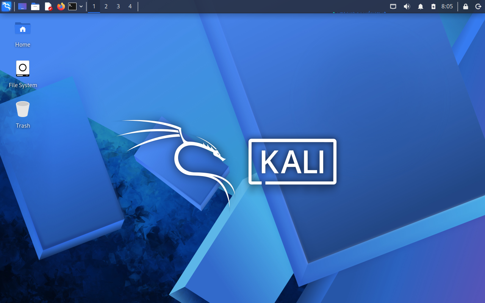
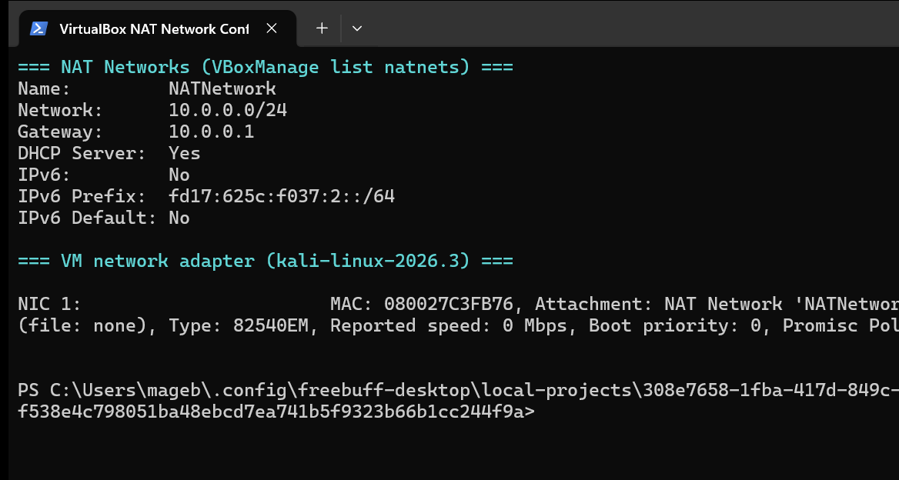
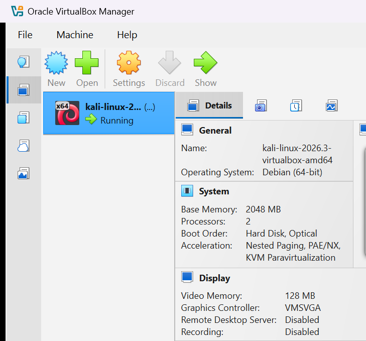
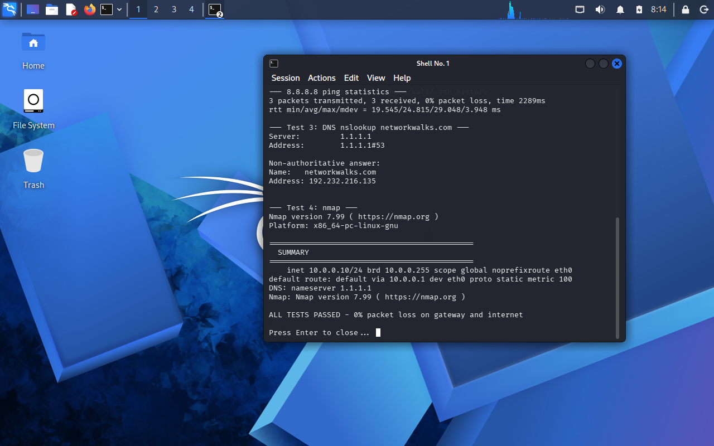

<div align="center">

# 🔐 Cybersecurity Lab Environment Setup

**Building an isolated virtual lab for penetration testing and ethical hacking practice**
</div>

<p align="center">
  
  
  
  
  
  
  
  
</p>

---

## 📌 Project Overview

This project sets up a **virtual cybersecurity and penetration-testing laboratory** using VirtualBox and Kali Linux.

The lab creates a controlled environment where reconnaissance, scanning, vulnerability assessment and other security-testing activities can be performed safely, repeatedly and legally. Every machine sits on a private virtual network so that additional target machines can be added in later projects.

---

## 🎯 Objectives

- Install and configure VirtualBox.
- Import Kali Linux as a virtual machine.
- Create a dedicated private **NAT Network** for the lab.
- Configure a consistent static IP for the Kali VM.
- Verify connectivity (gateway, internet, DNS) and tooling.
- Take a clean VM snapshot as a recovery baseline.
- Document the complete setup process.

---

## 🛡️ Purpose of the Lab

An isolated and controlled environment for cybersecurity learning and **authorized** security testing only:

- Network reconnaissance and port scanning
- Vulnerability assessment
- Packet and web traffic analysis
- Web security testing and tool experimentation

⚠️ **Important:** This lab and its tools must only be used against systems you own or have explicit written permission to test.

---

## 🏗️ Lab Architecture



The Kali machine is connected to a NAT Network, so future attacker/target VMs on the same network can talk to each other while still having outbound internet access.

---

## ⚙️ Lab Configuration

| 🧩 Component       | ⚙️ Configuration                |
| ------------------ | ------------------------------ |
| 🖥️ Host OS         | Windows 11 Pro                 |
| 🧠 Host RAM        | 16 GB                          |
| ⚡ Processor       | Intel Core i7-1185G7 @ 3.00GHz |
| 💻 Host Model      | Dell Latitude 7420             |
| 🧰 Hypervisor      | VirtualBox 7.2.22              |
| 🐉 Security OS     | Kali Linux 2026.3 (amd64)      |
| 🧠 Kali RAM        | 2048 MB (2 CPUs)               |
| 🌐 Virtual Network | NAT Network `NATNetwork`       |
| 📡 Network Address | 10.0.0.0/24                    |
| 🐧 Kali IP Address | 10.0.0.10/24 (static)          |
| 🚪 Default Gateway | 10.0.0.1                       |
| 🌍 DNS Server      | 1.1.1.1 (fallback 8.8.8.8)    |
| 💾 Snapshot        | `clean-static-net`             |

---

# 🪜 Lab Setup Procedure

## Step 1. Install 7-Zip

The official Kali VirtualBox appliance ships as a `.7z` archive, so 7-Zip (7zr command-line tool) was used to extract it.

---

## Step 2. Install VirtualBox

Oracle VirtualBox 7.2.22 was installed as the hypervisor.

---

## Step 3. Create the NAT Network

A dedicated NAT Network was created in VirtualBox:

```text
Name:        NATNetwork
IPv4 Prefix: 10.0.0.0/24
Gateway:     10.0.0.1
DHCP:        Enabled
IPv6:        Disabled
```



A **NAT Network** was chosen (instead of plain NAT) because every VM attached to it can communicate with the other VMs *and* still reach the internet — exactly what a multi-machine lab needs later.

---

## Step 4. Import Kali Linux

The Kali Linux 2026.3 VirtualBox image was downloaded from the official Kali website and imported into VirtualBox.

```text
Name:           kali-linux-2026.3-virtualbox-amd64
Base Memory:    2048 MB
Processors:     2
Boot Order:     Hard Disk, Optical
Adapter 1:      Attached to: NAT Network 'NATNetwork'
Adapter Type:   Intel PRO/1000 MT Desktop (82540EM)
```



---

## Step 5. Configure the Kali Linux Network

A consistent static IPv4 address was configured on `eth0`:

```text
IP Address:  10.0.0.10
Subnet Mask: 255.255.255.0
Gateway:     10.0.0.1
DNS:         1.1.1.1  (fallback 8.8.8.8)
```

---

## Step 6. Create a Clean VM Snapshot

After the network configuration a snapshot named:

```text
clean-static-net
```

was taken, described as *"Fresh Kali 2026.3 after network setup: NATNetwork 10.0.0.0/24, static IP 10.0.0.10/24 gw 10.0.0.1 dns 1.1.1.1,8.8.8.8"*.

This is the known-good baseline: any exercise that breaks the VM can be rolled back to it instantly.

---

# 🔎 Lab Verification

| ✅ Test                        | 🧾 Command                     | 🎯 Result                                  |
| ----------------------------- | ------------------------------ | ------------------------------------------ |
| 🌐 Check IP address           | `ip -4 addr show scope global` | `10.0.0.10/24` on `eth0`                   |
| 📡 Test gateway               | `ping 10.0.0.1`                | 3/3 received, **0% loss**, avg 0.69 ms      |
| 🌍 Test internet connectivity | `ping 8.8.8.8`                 | 3/3 received, **0% loss**, avg 22.4 ms      |
| 🔎 Test DNS resolution        | `nslookup networkwalks.com`    | Resolved via 1.1.1.1 → 192.232.216.135     |
| 🧰 Verify Nmap                | `nmap --version`               | Nmap 7.99, x86_64-pc-linux-gnu              |
| 🔄 Verify snapshot            | `clean-static-net` present     | Baseline snapshot confirmed by VirtualBox   |

### Example output

```text
inet 10.0.0.10/24 brd 10.0.0.255 scope global noprefixroute eth0
default route: default via 10.0.0.1 dev eth0 proto static metric 100
DNS: nameserver 1.1.1.1
Nmap: Nmap version 7.99 ( https://nmap.org )

ALL TESTS PASSED - 0% packet loss on gateway and internet
```



---

# 🐞 Problems Encountered & Solutions

## Problem 1. Host disk filled up during the Kali download/extraction

The Kali appliance archive plus its extracted disk image filled the C: drive to **0 bytes free**, which would have corrupted the extraction.

**Solution:** found and removed orphaned temporary installers left behind by earlier downloads (a 9 GB and a 5.7 GB `.tmp` file), re-checked free space, and only then completed the extraction.

---

## Problem 2. `VBoxManage guestcontrol` failed with a confusing path error

Running commands inside the VM from the host's Git Bash terminal failed with:

```text
No such file or directory "C:/.../usr/bin/bash" on guest
```

**Cause:** Git Bash converts Unix-style paths (`/bin/bash`) into Windows paths *before* VBoxManage receives them, so the guest was looking for a Windows path.

**Solution:** disable argument path conversion for that command:

```bash
export MSYS_NO_PATHCONV=1 MSYS2_ARG_CONV_EXCL='*'
VBoxManage guestcontrol <vm> run --exe /bin/bash -- ...
```

---

## Problem 3. Verification terminal would not open in the Kali GUI

Launching the verification script with `xfce4-terminal -e ...` returned `xfce4-terminal: command not found`.

**Cause:** the Kali 2026.3 XFCE image ships **qterminal**, not xfce4-terminal.

**Solution:** ran the script through the correct terminal emulator:

```bash
DISPLAY=:0 XAUTHORITY=/home/kali/.Xauthority qterminal -e 'bash /home/kali/verify.sh'
```

---

# 💡 What I Learned

1. **NAT vs NAT Network** — plain NAT isolates each VM; a *NAT Network* lets multiple VMs reach each other *and* the internet, which is what a multi-machine security lab requires.
2. **Virtual machine networking** — how VirtualBox adapter attachment types and adapter models (Intel PRO/1000 MT) affect connectivity.
3. **Static IPv4 addressing** — setting and verifying address, mask, gateway and DNS inside Kali so lab documentation stays reproducible.
4. **Snapshots** — take a clean snapshot *before* any risky activity; it is the cheapest insurance in a lab.
5. **Documentation** — recording commands, configuration, real output, problems and fixes is what makes a lab project professional and repeatable.

---

# 🔐 Security & Ethical Use

This laboratory is intended strictly for educational purposes, and only for testing systems you own or have explicit permission to test.

---

# 🔗 Tools & Resources

- **7-Zip:** https://7-zip.org/download.html
- **VirtualBox:** https://virtualbox.org/wiki/Downloads
- **Kali Linux:** https://www.kali.org/get-kali/

---

# 👤 Author

**Max007-coder**
Cybersecurity Intern — Batch B084

---

## 📌 Project Information

**Program Name:** Cybersecurity at Networkwalks | **Batch:** B084 | **Week:** 01 | **Project:** Cybersecurity & Pentesting Lab Setup | **Repository:** GitHub
